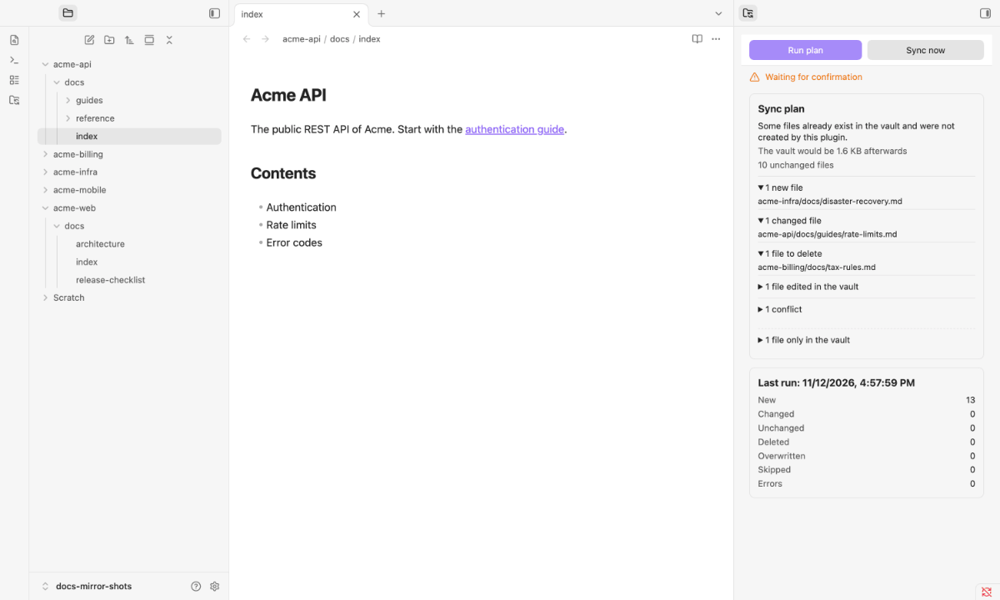
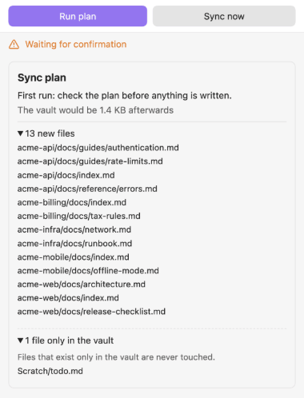
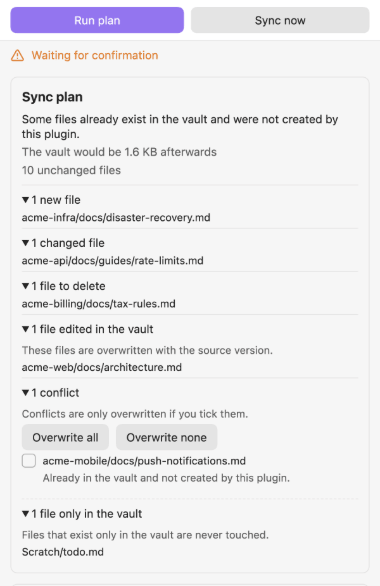
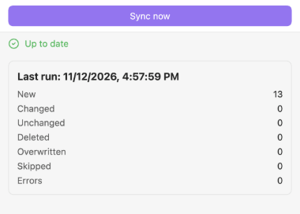
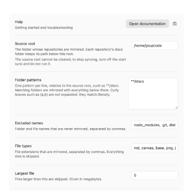

# Docs Mirror

> [🇬🇧 English](README.md) · 🇩🇪 Deutsch

**Kopiert die `docs`-Ordner vieler Repositories einseitig in einen kleinen Obsidian-Vault, den du auf Desktop und Telefon lesen kannst.**

Die Repositories bleiben die Quelle der Wahrheit. Der Vault ist eine Leseansicht: Er wird nie zurück in ein Repository geschrieben.

Version 0.1.0. Das Plugin läuft nur auf dem Desktop, weil es die Quellordner mit Node.js liest. Auf dem Telefon liest du den Vault über Obsidian Sync; dort läuft das Plugin nicht.

## Was es tut

- Findet unter einem Quellordner alle Ordner, die einem Ordnermuster entsprechen (Standard `**/docs`), damit ein neues Repository ohne Konfiguration erscheint.
- Hält jede Datei unter ihrem Pfad unterhalb des Quellordners, damit relative Links innerhalb eines `docs`-Ordners weiter funktionieren.
- Bildet vor dem Schreiben einen Plan: neu, geändert, unverändert, zu löschen, Konflikte und Dateien, die nur im Vault liegen.
- Zeigt den Plan in der Seitenleiste. Der erste Lauf wartet immer auf deine Bestätigung. Ändert sich der Plan zwischen deiner Bestätigung und der Ausführung, wartet der Lauf erneut und zeigt den neuen Plan.
- Löscht und überschreibt nur Dateien, die das Plugin gespiegelt hat, so wie es sie in seiner Liste pro Gerät verzeichnet. Eine Datei, die schon im Vault liegt und das Plugin nicht angelegt hat, ist ein Konflikt: Sie wird nur überschrieben, wenn du sie ankreuzt; hat sie den Inhalt der Quelle, wird sie ohne Schreiben in die Liste übernommen. Dateien, die nur im Vault liegen, fasst es nie an.
- Überschreibt Dateien, die du im Vault bearbeitet hast, mit der Fassung aus der Quelle. Ein Lauf, der auf deine Bestätigung wartet, führt sie in der Vorschau als „im Vault verändert“; ein Lauf ohne andere Gründe überschreibt sie direkt.
- Löscht nichts, wenn der Quellordner fehlt oder keine Dateien liefert.
- Fragt vor einem Lauf nach, wenn einer von fünf Gründen vorliegt: der erste Lauf; viele Löschungen (Schwelle); die Einstellungen haben sich seit dem letzten Lauf geändert; der gespiegelte Vault überschreitet die Gesamtgrößen-Grenze; Konflikte. Konflikte werden nur überschrieben, wenn du sie ankreuzt; Konflikte bei Groß- und Kleinschreibung sowie bei Typen werden nie überschrieben. Einzelheiten (englisch): [Sync plan reference](https://github.com/johannes-kaindl/docs-mirror/blob/main/docs/reference-plan.md) und [What does a conflict mean](https://github.com/johannes-kaindl/docs-mirror/blob/main/docs/how-to-conflicts.md).
- Überspringt symbolische Links, Punkt-Ordner (wenn du sie nicht einschließt), Dateien über der Größengrenze und Dateitypen, die du nicht aufgenommen hast.
- Schreibt jede Datei über eine Temp-Datei; keine Datei bleibt halb geschrieben zurück, eine unterbrochene Ersetzung kann aber eine Datei fehlen lassen, bis der nächste Lauf sie wiederherstellt.

## Voraussetzungen

- **Obsidian 1.11.4 oder neuer**, nur Desktop (`isDesktopOnly: true` in `manifest.json`). Das Plugin liest die Quellordner mit Node.js und lädt deshalb nicht auf dem Telefon.
- Ein **Quellordner**: ein Ordner auf demselben Rechner, der deine Repositories enthält. Seinen absoluten Pfad trägst du in den Einstellungen ein.
- Ein **eigener, leerer Vault** für den Spiegel. Nimm nicht den Arbeitsbereich selbst als Vault.
- Zum Lesen auf dem Telefon: Obsidian Sync (oder ein anderer Weg, den Vault zu synchronisieren). Das Plugin synchronisiert nicht selbst.

## Installation

Das Plugin steht noch nicht im Community-Plugin-Store; der Store-Eintrag ist in Vorbereitung.

Für eine manuelle Installation lädst du `main.js`, `manifest.json` und `styles.css` aus dem [neuesten Release](https://github.com/johannes-kaindl/docs-mirror/releases/latest) herunter, kopierst sie nach `<Vault>/.obsidian/plugins/docs-mirror/` und aktivierst das Plugin in den Community-Plugins.

Zum Bauen aus dem Quellcode führst du `npm install` und danach `npm run build` aus.

Für die Ersteinrichtung folge [docs/getting-started.md](https://github.com/johannes-kaindl/docs-mirror/blob/main/docs/getting-started.md). Die übrige Dokumentation (englisch) steht im Verzeichnis [docs/README.md](https://github.com/johannes-kaindl/docs-mirror/blob/main/docs/README.md).

## Verwendung

1. Aktiviere **Docs Mirror** unter Einstellungen → Community-Plugins.
2. Öffne die Einstellungen des Plugins und trage unter **Quellordner** den absoluten Pfad deines Quellordners ein. Solange er fehlt, zeigt die Seitenleiste **Nicht eingerichtet**.
3. Öffne die Seitenleiste über das Ribbon-Symbol oder den Befehl **Docs Mirror öffnen** und klicke **Jetzt synchronisieren**.
4. Der erste Lauf schreibt nie direkt. Die Seitenleiste zeigt den Sync-Plan; prüfe ihn, kreuze Konflikte an, die du überschreiben willst, klicke **Plan ausführen** und bestätige im Fenster.
5. Spätere Läufe gehen ohne Rückfrage durch, solange keiner der fünf Gründe oben zutrifft. Wartet ein Lauf, bleibt er in der Seitenleiste, bis du ihn bestätigst oder abbrichst.

 Vorschau anklicken für das Bild in voller Größe

 Vorschau anklicken für das Bild in voller Größe

 Vorschau anklicken für das Bild in voller Größe

Schritt für Schritt mit den Gründen dahinter (englisch): [Getting started](https://github.com/johannes-kaindl/docs-mirror/blob/main/docs/getting-started.md).

### Befehle

- **Docs Mirror öffnen:** öffnet die Seitenleiste. Das Ribbon-Symbol tut dasselbe.
- **Docs jetzt synchronisieren:** startet einen Lauf. Der Knopf in der Seitenleiste tut dasselbe.
- **Sync-Plan anzeigen:** öffnet die Seitenleiste mit dem Plan, der auf Bestätigung wartet. Wartet kein Plan, sagt es das. Alle Befehle, Knöpfe und Meldungen (englisch): [docs/reference-commands.md](https://github.com/johannes-kaindl/docs-mirror/blob/main/docs/reference-commands.md).

## Konfiguration

Alle Einstellungen stehen unter Einstellungen → Docs Mirror. Der Quellordner wird gerätelokal gespeichert und muss auf jedem Gerät gesetzt werden; die übrigen Einstellungen liegen in der `data.json` des Plugins.

 Vorschau anklicken für das Bild in voller Größe

- **Quellordner:** der absolute Pfad des Ordners, dessen Repositories gespiegelt werden. `~` und relative Pfade werden abgelehnt.
- **Ordnermuster:** ein Muster je Zeile, relativ zum Quellordner. Passende Ordner werden mit allem darunter gespiegelt. Siehe [Adjust the folder patterns](https://github.com/johannes-kaindl/docs-mirror/blob/main/docs/how-to-folder-patterns.md) (englisch).
- **Ausgeschlossene Namen:** Ordner- und Dateinamen, die nie gespiegelt werden, durch Komma getrennt. Standard: `node_modules`, `.git`, `dist`, `build`, `__pycache__`, `.venv`.
- **Dateitypen:** Dateiendungen, die gespiegelt werden, durch Komma getrennt. Standard: `md`, `canvas`, `base`, `png`, `jpg`, `jpeg`, `gif`, `svg`, `webp`, `pdf`.
- **Größte Datei:** Dateien über dieser Größe werden übersprungen. Angabe in Megabyte. Standard: 5 MB.
- **Gesamtgrößen-Grenze:** ein Lauf, der den gespiegelten Vault über diese Größe brächte, fragt vorher nach. Angabe in Megabyte. Standard: 1024 MB (1 GB).
- **Schwelle für Bestätigung:** ein Lauf, der mindestens so viele Dateien löscht und dabei mindestens ein Fünftel der gespiegelten Dateien trifft, fragt vorher nach. Standard: 20 Dateien. Der Fünftel-Anteil ist fest und nicht einstellbar.
- **Punkt-Ordner:** Ordner einbeziehen, deren Name mit einem Punkt beginnt. Standardmäßig aus.
- **Beim Vault-Start synchronisieren:** zwei Sekunden nach dem Laden des Arbeitsbereichs einen Lauf starten. Standardmäßig aus. Braucht der Lauf eine Bestätigung, wartet er in der Seitenleiste und zeigt eine Mitteilung statt eines Fensters. Ist schon ein Lauf, eine Bestätigung oder ein wartender Plan vorhanden, entfällt der Startlauf still. Jede Einstellung im Einzelnen (englisch): [Settings reference](https://github.com/johannes-kaindl/docs-mirror/blob/main/docs/reference-settings.md).

## Funktionsweise

Ein Lauf hat vier Schritte. Das Plugin liest die Quelle nur; es schreibt nur in den Vault, und zwar nur über den Vault-Adapter von Obsidian.

1. **Scan.** Es geht mit Node.js (`readdir`, `lstat`, nur lesend) durch den Quellordner, behält die Ordner, die einem Ordnermuster entsprechen, und sammelt ihre Dateien. Symbolische Links, ausgeschlossene Namen, nicht aufgenommene Dateitypen und Dateien über der Größengrenze fallen heraus. Liegt der Vault unter dem Quellordner, bleibt er außerhalb des Scans.
2. **Plan.** Es vergleicht den Scan mit dem Vault und mit der Liste der Dateien, die es früher gespiegelt hat (pro Gerät im lokalen Speicher von Obsidian, nie im Vault). Jede Datei wird neu, geändert, unverändert, zu löschen, Konflikt, im Vault verändert oder nur im Vault.
3. **Schutz.** Eine fehlende oder leere Quelle blockiert den Lauf, damit ein falscher Pfad den Vault nicht leert. Fünf Gründe lassen den Lauf in der Seitenleiste auf deine Bestätigung warten: der erste Lauf, viele Löschungen, geänderte Einstellungen, die Größengrenze, Konflikte.
4. **Ausführen.** Zuerst die Löschungen. Jede Datei wird dann in eine Temp-Datei geschrieben und an ihren Platz verschoben, und die Liste wird schrittweise gespeichert, sodass ein Abbruch behält, was schon erledigt ist.

Warum Änderungen nur in eine Richtung fließen, wofür die Liste da ist und was das Plugin nie anfasst (englisch): [docs/explanation-how-it-works.md](https://github.com/johannes-kaindl/docs-mirror/blob/main/docs/explanation-how-it-works.md). Den Modulaufbau beschreibt die `AGENTS.md`.

## Grenzen

- Der Spiegel ist einseitig. Änderungen im Vault werden nie in die Repositories zurückkopiert. Warum, und was gemessen ist (englisch): [docs/explanation-how-it-works.md](https://github.com/johannes-kaindl/docs-mirror/blob/main/docs/explanation-how-it-works.md).
- Es gibt keinen Dateiwächter und keinen Zeitplan. Ein Lauf startet, wenn du ihn anstößt oder, wenn du es eingestellt hast, beim Start des Vaults.
- Eine gespiegelte Datei wird im Vault gelöscht, wenn ihre Quelle verschwindet, ein symbolischer Link wird, die Größengrenze überschreitet oder sie in einen nicht aufgenommenen Dateityp wechselt; das gilt aber nur, wenn du sie im Vault nicht bearbeitet hast. Eine dort bearbeitete Datei bleibt liegen, und das Plugin vergisst sie und löscht sie nie.
- Links, die aus dem `docs`-Ordner hinausführen, etwa `../src/…`, brechen im Vault.
- Das Plugin liest keine `.gitignore`. Nutze stattdessen die ausgeschlossenen Namen und die Ordnermuster.
- Spiegle in einen Vault nur von einem Gerät aus; jedes Gerät führt seine eigene Liste, zwei Geräte würden sich gegenseitig die Dateien überschreiben.
- Die Gesamtgrößen-Grenze vergleicht die Größe des Spiegels nach dem Lauf mit der Grenze, nicht den Zuwachs eines einzelnen Laufs.

## Dokumentation

Neu hier? Beginne mit [Getting started](https://github.com/johannes-kaindl/docs-mirror/blob/main/docs/getting-started.md) (englisch). Etwas funktioniert nicht? Die Seite [Commands, buttons and messages](https://github.com/johannes-kaindl/docs-mirror/blob/main/docs/reference-commands.md) (englisch) nennt jede Meldung mit Ursache und dem, was zu tun ist. Der [Doku-Index](https://github.com/johannes-kaindl/docs-mirror/blob/main/docs/README.md) (englisch) führt alles auf; er folgt dem Diátaxis-Schema:

- **Tutorial** — Docs Mirror einmal einrichten, den ersten Abgleich fahren und den Vault auf dem Handy lesen.
- **Anleitungen** — wählen, welche Ordner gespiegelt werden; einen Konflikt verstehen und entscheiden, was damit geschieht.
- **Referenz** — jede Einstellung, der Sync-Plan, die Befehle, Knöpfe und Meldungen.
- **Erklärung** — warum Änderungen nur von den Repositories in den Vault fließen, wofür die Liste je Gerät da ist und was das Plugin löscht und nie anfasst.

## Stand

Version 0.1.0, das erste Release. Der Store-Eintrag ist in Vorbereitung.

## Mitwirken

Issues und Pull Requests sind willkommen. Führe vor einem Commit `npm run gate` aus; siehe [`CONTRIBUTING.md`](CONTRIBUTING.md) und [`AGENTS.md`](AGENTS.md).

## Lizenz

- **Code:** AGPL-3.0-or-later ([`LICENSE`](LICENSE); Dual-License-Option in [`LICENSING.md`](LICENSING.md)).
- **Doku/Text:** CC BY-SA 4.0 ([`LICENSE-DOCS`](LICENSE-DOCS)).

Copyright © 2026 Johannes Kaindl.
